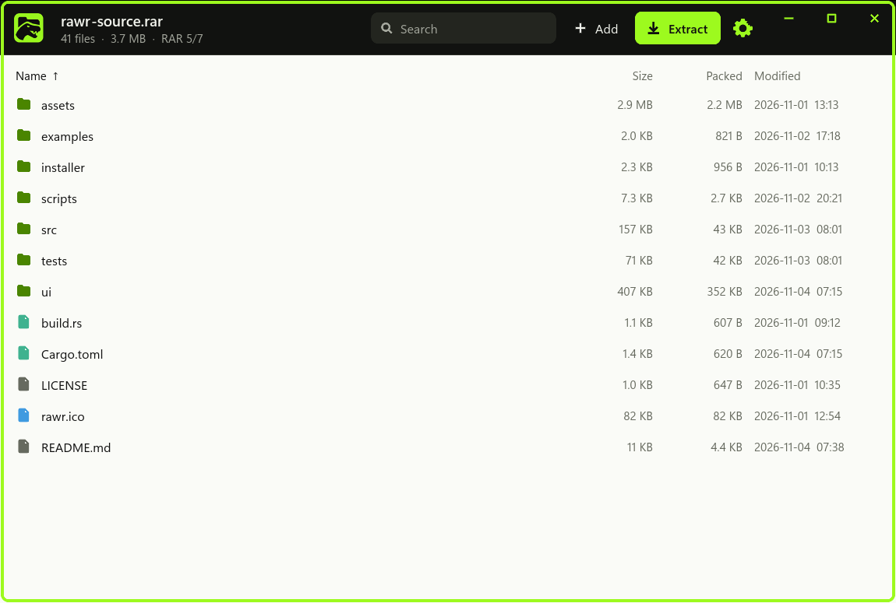

# rawr

A clean, minimal Windows app for RAR, ZIP, 7z and gzip archives, written in Rust. It's a
single exe with a [Slint](https://slint.dev) interface: no web view, no runtime to
install, and no nag screen.

Its RAR support comes from [rawrs-engine](https://github.com/msderganc/rawrs-engine), a
copy of the [rars](https://github.com/bitplane/rars) library reworked for speed and
memory. On the benchmark below, rawr is faster than WinRAR on 57 of 60 operations.



## What it does

- **Opens** every RAR generation, from DOS-era RAR 1.3 to RAR 7, including multi-part
  sets and encrypted archives
- **Opens and extracts** ZIP, 7z and gzip too, including encrypted ZIP and 7z
- **Creates** RAR 4, 5 or 7 archives, with compression level, password, hidden file
  names, solid mode, split parts, recovery record and comment
- **Changes** an archive in place: add, rename and delete files, and edit its comment
- **Extracts** everything or a selection, with progress, speed and Cancel
- **Browses** with sorting, search across the whole archive, recent archives, and light
  and dark themes
- **Drags** files out to Explorer, up to 300 MB at a time
- **Tests** integrity, and **repairs** archives that have a recovery record
- **Opens** a file straight from the archive, warning first if it's a program
- **Explorer integration**, optional in Settings: "Extract here" and "Add to archive"
  menus, and a shortcut to make rawr your default

Keyboard: Enter opens, Backspace goes up, Delete deletes, F2 renames, Ctrl+A selects all,
Ctrl+F searches.

## Install

Download `rawr-<version>-setup.exe` from
[Releases](https://github.com/msderganc/rawr/releases) and run it. It installs for your
user only, with no admin prompt, and adds rawr to "Open with" and Default apps for `.rar`,
`.zip`, `.7z`, `.gz` and `.tgz` without taking over your current default. Uninstalling
removes all of that, along with rawr's Explorer menus and settings.

Or download `rawr.exe` on its own: it runs from anywhere without installing.

## Performance

rawr against WinRAR 7.23's command-line `Rar.exe` and `UnRAR.exe`, both making RAR 5
archives, measured with [`scripts/bench.ps1`](scripts/bench.ps1). A score of 100 matches
WinRAR and higher is better: 150 means WinRAR takes 1.5 times as long, or as much memory.

| Score | rawr | What it measures |
|---|---:|---|
| **Overall** | **126** | 70% speed, 20% resources, 10% size |
| Speed | 143 | Wall time, faster on 57 of 60 operations |
| Resources | 92 | Peak memory 82, CPU time 104 |
| Size | 97 | Archive size on the create operations |

| | Speed | Peak memory | CPU time | Size |
|---|---:|---:|---:|---:|
| Creating (40 operations) | 135 | 83 | 114 | 97 |
| Extracting (10) | 158 | 71 | 74 | |
| Testing (10) | 159 | 92 | 102 | |

Put simply, rawr needs about 70% of WinRAR's time overall, and under two-thirds to
extract or test. The three operations where it isn't faster are within 0.01 seconds.
What it gives up is memory: creating archives from many files can take two to three
times as much, and extracting buffers more so it can write files on background threads.
Its archives come out about 3% larger.

### Detailed results

Times are in seconds and memory is peak working set in MB. "Faster" is how many times as
long WinRAR took, so 1.50x means rawr finished in two-thirds of the time.

#### 96 mixed files, 384 MB

| Operation | rawr | WinRAR | Faster | rawr memory | WinRAR memory | rawr archive | WinRAR archive |
|---|---:|---:|---:|---:|---:|---:|---:|
| Fast | 1.08 | 1.81 | 1.67x | 283 | 134 | 143.7 MB | 138.1 MB |
| Level 2 | 1.85 | 2.13 | 1.15x | 316 | 152 | 124.9 MB | 118.8 MB |
| Level 4 | 3.19 | 4.57 | 1.43x | 402 | 236 | 114.4 MB | 111.8 MB |
| Level 5 | 3.62 | 4.77 | 1.32x | 399 | 235 | 113.7 MB | 111.7 MB |
| Normal | 2.62 | 2.88 | 1.10x | 400 | 157 | 116.0 MB | 112.2 MB |
| Extract | 0.35 | 1.29 | 3.66x | 126 | 31 |  |  |
| Test | 0.31 | 1.09 | 3.52x | 128 | 31 |  |  |
| Solid fast | 1.04 | 1.25 | 1.20x | 839 | 297 | 54.4 MB | 58.0 MB |
| Solid level 5 | 3.22 | 4.37 | 1.36x | 949 | 590 | 35.7 MB | 38.8 MB |
| Solid normal | 2.46 | 2.83 | 1.15x | 550 | 318 | 45.2 MB | 39.3 MB |
| Solid extract | 0.82 | 0.81 | 0.99x | 117 | 57 |  |  |
| Solid test | 0.60 | 0.62 | 1.04x | 121 | 57 |  |  |

#### Node.js install and Rust source tree, 113 MB

| Operation | rawr | WinRAR | Faster | rawr memory | WinRAR memory | rawr archive | WinRAR archive |
|---|---:|---:|---:|---:|---:|---:|---:|
| Fast | 0.78 | 1.10 | 1.43x | 284 | 304 | 43.8 MB | 41.5 MB |
| Level 2 | 1.12 | 1.57 | 1.41x | 489 | 325 | 38.9 MB | 36.0 MB |
| Level 4 | 1.63 | 2.49 | 1.52x | 508 | 597 | 35.2 MB | 34.2 MB |
| Level 5 | 1.89 | 2.62 | 1.38x | 531 | 596 | 34.9 MB | 34.2 MB |
| Normal | 1.39 | 1.96 | 1.41x | 521 | 325 | 35.9 MB | 34.4 MB |
| Extract | 1.11 | 1.91 | 1.72x | 119 | 61 |  |  |
| Test | 0.25 | 0.60 | 2.38x | 69 | 61 |  |  |
| Solid fast | 0.93 | 0.96 | 1.04x | 265 | 302 | 42.2 MB | 39.5 MB |
| Solid level 5 | 2.22 | 2.86 | 1.29x | 773 | 595 | 33.6 MB | 31.8 MB |
| Solid normal | 1.49 | 2.07 | 1.39x | 467 | 322 | 35.0 MB | 32.1 MB |
| Solid extract | 1.34 | 1.83 | 1.37x | 97 | 57 |  |  |
| Solid test | 0.40 | 0.40 | 1.00x | 99 | 57 |  |  |

#### One executable, 89 MB

| Operation | rawr | WinRAR | Faster | rawr memory | WinRAR memory | rawr archive | WinRAR archive |
|---|---:|---:|---:|---:|---:|---:|---:|
| Fast | 0.39 | 0.46 | 1.18x | 203 | 300 | 33.5 MB | 31.5 MB |
| Level 2 | 0.78 | 0.81 | 1.04x | 372 | 319 | 28.8 MB | 26.6 MB |
| Level 4 | 1.27 | 1.53 | 1.20x | 422 | 593 | 25.6 MB | 24.8 MB |
| Level 5 | 1.53 | 1.65 | 1.08x | 478 | 593 | 25.4 MB | 24.8 MB |
| Normal | 1.03 | 1.10 | 1.07x | 382 | 322 | 26.2 MB | 25.0 MB |
| Extract | 0.25 | 0.34 | 1.36x | 55 | 57 |  |  |
| Test | 0.25 | 0.31 | 1.25x | 54 | 57 |  |  |
| Solid fast | 0.42 | 0.46 | 1.11x | 200 | 300 | 33.5 MB | 31.5 MB |
| Solid level 5 | 1.64 | 1.68 | 1.03x | 563 | 593 | 26.2 MB | 24.8 MB |
| Solid normal | 0.98 | 1.12 | 1.14x | 444 | 321 | 27.3 MB | 25.0 MB |
| Solid extract | 0.25 | 0.34 | 1.38x | 56 | 57 |  |  |
| Solid test | 0.22 | 0.31 | 1.38x | 54 | 57 |  |  |

#### Rust source tree, 473 files, 11 MB

| Operation | rawr | WinRAR | Faster | rawr memory | WinRAR memory | rawr archive | WinRAR archive |
|---|---:|---:|---:|---:|---:|---:|---:|
| Fast | 0.13 | 0.27 | 2.07x | 74 | 62 | 5.8 MB | 5.6 MB |
| Level 2 | 0.19 | 0.28 | 1.49x | 210 | 71 | 5.7 MB | 5.4 MB |
| Level 4 | 0.22 | 0.37 | 1.71x | 202 | 91 | 5.5 MB | 5.4 MB |
| Level 5 | 0.22 | 0.34 | 1.54x | 205 | 92 | 5.5 MB | 5.4 MB |
| Normal | 0.20 | 0.34 | 1.70x | 203 | 70 | 5.6 MB | 5.4 MB |
| Extract | 0.22 | 0.44 | 2.00x | 44 | 27 |  |  |
| Test | 0.06 | 0.22 | 3.55x | 23 | 27 |  |  |
| Solid fast | 0.15 | 0.24 | 1.59x | 100 | 174 | 5.4 MB | 5.1 MB |
| Solid level 5 | 0.29 | 0.40 | 1.40x | 269 | 326 | 4.9 MB | 4.7 MB |
| Solid normal | 0.22 | 0.34 | 1.56x | 230 | 184 | 5.0 MB | 4.8 MB |
| Solid extract | 0.22 | 0.32 | 1.47x | 41 | 35 |  |  |
| Solid test | 0.09 | 0.10 | 1.04x | 37 | 34 |  |  |

#### Random data, 64 MB

| Operation | rawr | WinRAR | Faster | rawr memory | WinRAR memory | rawr archive | WinRAR archive |
|---|---:|---:|---:|---:|---:|---:|---:|
| Fast | 0.46 | 0.45 | 0.97x | 210 | 306 | 64.0 MB | 64.0 MB |
| Level 2 | 0.63 | 1.13 | 1.79x | 273 | 329 | 64.0 MB | 64.0 MB |
| Level 4 | 0.73 | 1.07 | 1.46x | 341 | 600 | 64.0 MB | 64.0 MB |
| Level 5 | 0.86 | 1.08 | 1.26x | 408 | 600 | 64.0 MB | 64.0 MB |
| Normal | 0.76 | 1.17 | 1.54x | 306 | 330 | 64.0 MB | 64.0 MB |
| Extract | 0.06 | 0.10 | 1.66x | 11 | 20 |  |  |
| Test | 0.06 | 0.09 | 1.50x | 3 | 20 |  |  |
| Solid fast | 0.40 | 0.41 | 1.04x | 215 | 302 | 64.0 MB | 64.1 MB |
| Solid level 5 | 0.63 | 1.04 | 1.65x | 596 | 596 | 64.0 MB | 64.1 MB |
| Solid normal | 0.48 | 1.14 | 2.38x | 415 | 326 | 64.0 MB | 64.1 MB |
| Solid extract | 0.14 | 0.16 | 1.19x | 64 | 54 |  |  |
| Solid test | 0.12 | 0.15 | 1.25x | 61 | 54 |  |  |

<details>
<summary>How it was measured</summary>

- Five data sets: 96 mixed files (384 MB); a Node.js install together with a Rust source
  tree (113 MB); the Rust source tree alone (473 files, 11 MB); one 89 MB executable; and
  64 MB of random data
- Twelve operations on each: creating at Fast, levels 2, 4 and 5, and Normal; creating
  solid at Fast, level 5 and Normal; then extracting and testing a plain and a solid
  archive. Both sides read the same archives, made by WinRAR.
- Best of 3 runs, scored as geometric means. Every archive rawr made was checked with
  UnRAR.
- Intel Core i9-12900K, 64 GB, Windows 11, November 2026
- The script drives rawr's engine through [`examples/bench.rs`](examples/bench.rs), the
  same code the app runs, without the window

To run it yourself, with WinRAR installed:

```powershell
pwsh scripts/bench.ps1 -Path <folder or file>[,<another>] [-Runs 3] [-Csv results.csv]
```

</details>

## Good to know

- Editing rebuilds the archive, so it takes about as long as extracting and
  recompressing it. The original is replaced only after the new one is finished.
  Split archives and archives containing links can't be edited.
- Files appear in the destination only after their checksum passes.
- Entries that could escape the chosen folder or misbehave on Windows are skipped and
  listed: path traversal, alternate data streams, device names like `CON`, and names
  that differ only by case. Symlinks and junctions are never created.
- Repair reads the whole archive into memory.
- The default compression level is Fast, for new archives and edits. Many separate files
  compress faster than one large one, because they spread across more threads.
- Extracting a selection skips the other files where it can. Solid and split RAR archives
  and 7z still have to decode everything before the files you chose.
- Multi-part ZIP and 7z sets aren't supported.
- A `.tar.gz` extracts to its `.tar`, without unpacking further. gzip can't state its full
  size reliably, so that shows as unknown and progress follows the compressed data.
- rawr can't make self-extracting archives.

## Build

Needs Rust and the Visual Studio C++ build tools.

```bash
cargo build --release
```

The app is the single file `target/release/rawr.exe`.

For the installer, install [NSIS](https://nsis.sourceforge.io), then:

```bash
makensis /DVERSION=0.4.0 installer\rawr.nsi
```

## Test

```bash
cargo test
```

Run every sample archive from a rawrs-engine checkout through extraction:

```bash
RARS_FIXTURES=path/to/rawrs-engine/crates/rars/tests/fixtures cargo test --release --test engine sweep -- --ignored --nocapture
```

Check that another RAR decoder accepts the archives rawr writes:

```bash
RAR_DECODER=path/to/decoder cargo test --release --test authoring external_decoder -- --ignored --nocapture
```

## Credits

rawr's archive support is built on [rars](https://github.com/bitplane/rars) by
bitplane, a RAR library in pure Rust that reads every RAR generation and writes RAR 4,
5 and 7. rawrs-engine is a modified copy of rars: the speed and memory changes are ours,
and nearly everything else, from the format support to encryption and recovery records,
is rars' work. Thanks to its authors for making it available under
Apache-2.0.

## Licences

rawr is MIT. `src/volumes.rs` and `tests/fixtures` come from [rars](https://github.com/bitplane/rars) and stay under
Apache-2.0, as does rawrs-engine. Slint is used under its royalty-free licence, which
requires the credit in the About screen. See [THIRD-PARTY-NOTICES.md](THIRD-PARTY-NOTICES.md).
